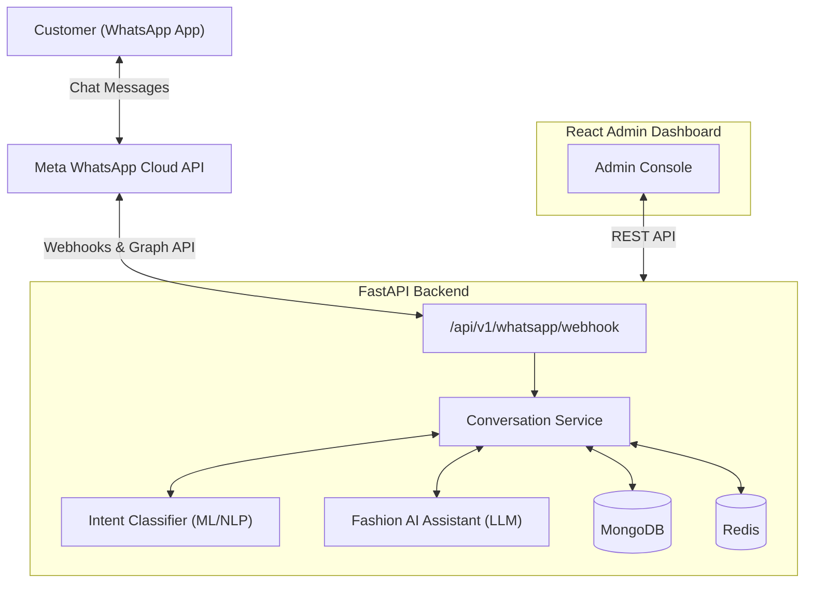

# 🏗️ System Architecture

## Architectural Highlights
- **FastAPI Core**: Lightweight asynchronous ASGI web server.
- **Service & Repository Pattern**: Clean decoupling between HTTP layer, business logic, and database queries.
- **Modular AI Layer**: Dedicated modules for lightweight intent detection and LLM-driven fashion styling dialogue.
